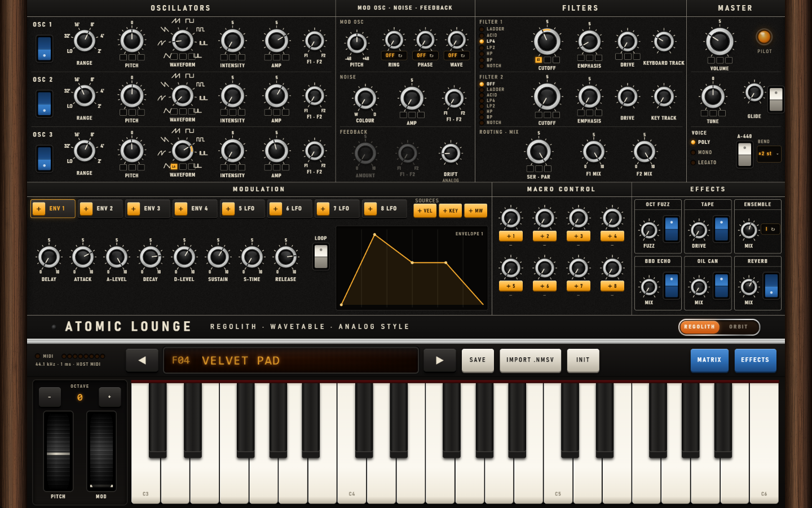
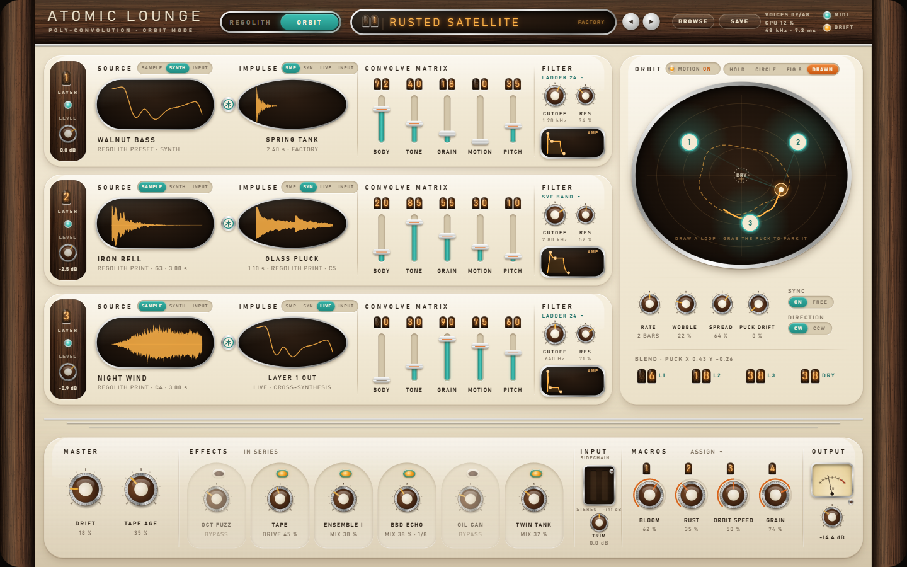

# Atomic Lounge

**Atomic Lounge (formerly Vintage Chonk)** is a warm, modern-classic synthesizer: a VST3 instrument and
standalone app for Windows with two engines. **REGOLITH** is the synth, an original sound engine behind a
1970s-style panel; **ORBIT** is a poly-convolution engine for organic sound design, which can also take live
audio from other tracks. It also converts Native Instruments Massive presets (`.nmsv`) into its own sounds.

Source code: https://github.com/quietorbit72/atomic-lounge. Downloads (zip with the VST3, the standalone app,
the user guide and checksums): the Releases page of that repository.



## REGOLITH features

* **3 oscillators** with eight classic analogue-style waveforms (triangle, "shark", reverse saw, saw, square
  and three pulses), footage ranges 64' to 1', fine tune and a phase-bend intensity.
* **Mod oscillator** for ring, phase and wave-position modulation; **noise** with colour.
* **2 filters**: LADDER (24 dB transistor ladder), ACID (303-style diode ladder), LP4, LP2, HP, BP, NOTCH;
  serial, parallel or anything between.
* **4 envelopes** with delay, attack level, decay level, sustain time and loop.
* **4 modulators**, each an LFO, a 16-step Performer (32 curve shapes) or a 16-step Stepper; 16 modulation
  routings, 8 macros, velocity, key, mod wheel, aftertouch, bend and random as sources.
* **6 effects** in a fixed chain: OCT FUZZ, TAPE, ENSEMBLE, BBD ECHO, OIL CAN, REVERB (TWIN TANK or SPRING);
  both echoes can sync to the host tempo.
* **16 voices**, poly / mono / legato, glide.
* **16 factory presets** as host programs (plus the 11 ORBIT presets); your own presets saved by name.
* **22 automatable host parameters** (8 macros, master, filter cutoffs and emphasis, mod osc, effect levels,
  glide); full state saved with the DAW project.
* **IMPORT .NMSV**: converts Native Instruments Massive (original, not Massive X) presets on the spot, with a
  report of what carried over. The converter also exists as a single offline web page
  (`editor/converter.html`) and as a Python tool (`tools/preset_converter/convert.py`).
* Any sample rate and block size: the engine runs at 44.1 kHz with a high-quality resampler; output does not
  depend on the host's block size; 1.5-2.2 ms latency, reported to the host.

## ORBIT

ORBIT is an original poly-convolution / cross-synthesis engine: three layers, each a source (a sample, a
REGOLITH synth voice, or the live input) combined with an impulse (a sample, a generated impulse, a printed
synth sound, another layer playing live, or the live input) along five separate dimensions:

* **BODY**: true convolution: the impulse's resonance and space.
* **TONE**: the impulse's colour (spectral envelope) only.
* **GRAIN**: the impulse's texture and fine structure only.
* **MOTION**: the impulse's loudness contour and transients.
* **PITCH**: the impulse's partials re-tuned to the played note.

An orbit blender mixes the layers and the dry sound with a puck that circles, traces a figure of eight or
follows a loop you draw, or stays parked where you put it (and moves only by automation, macros or the
modulation matrix); 32 modulation slots, 4 macros, drift, tape age and the six effects. Samples (WAV, AIFF,
FLAC) are dragged onto the panel and saved inside the DAW project.

**Live input**: one stereo sidechain input. Route another track to it in your DAW and use it as a layer's
source (gated by the audio or by held notes) or as its impulse: BODY convolves with a continuously captured
window of the input, TONE / GRAIN / MOTION / PITCH use it as the live modulator.

11 factory presets (host programs 17-27), 54 automatable parameters, latency 347 samples at 48 kHz, reported
to the host. Technical overview: `docs/ORBIT_MODE.md`; renders of the presets: `examples/orbit/presets/`.

**Compatibility**: the plugin's identity (VST3 class IDs), its parameters and its project
format are unchanged by the rename, so projects saved with the 1.0.0 and 1.1.0 releases load and sound as
before. Remove an old `Vintage Chonk.vst3` from your VST3 folder when you install `Atomic Lounge.vst3`; until
then a DAW may list both.



The full user guide is `docs/guide/Atomic-Lounge-User-Guide.pdf`. It also covers the same engine as
replacement firmware for the M-VAVE FM-1 keyboard and as an Android tablet app; those two builds live outside
this repository (the FM-1 firmware depends on M-VAVE's SDK).

## Build the VST3 and the standalone app (Windows x64)

Needs: Visual Studio 2022 Build Tools (MSVC, Windows SDK 10.0.26100), git, LLVM for Windows (`clang-cl.exe`
in `C:\Program Files\LLVM`, or set `MFE_CLANG_CL`), and optionally node (regenerates the factory bank header).

```powershell
git clone https://github.com/quietorbit72/atomic-lounge.git
cd atomic-lounge
powershell -ExecutionPolicy Bypass -File plugin\build.ps1 -Test
```

`plugin\build.ps1` first runs `plugin\fetch_deps.ps1`, which downloads the third-party code at pinned versions
and checks each by commit or SHA-256: JUCE 8.0.15 (with one small patch, see `plugin/patches/`) and Microsoft's
WebView2 SDK 1.0.4314.35. Output: `plugin\dist\Atomic Lounge.vst3` and the standalone `plugin\dist\Atomic Lounge.exe`. Install it by copying that folder into
`C:\Program Files\Common Files\VST3\` (admin), then rescan plugins in your DAW. Details, the host test and
Steinberg's validator: `plugin/README.md`.

## Other tests

```powershell
powershell -ExecutionPolicy Bypass -File run_tests.ps1    # engine and ORBIT core (C), converter (Python), web pages (node)
```

The C tests need gcc or clang; the page tests use headless Chrome when it is installed.

## Repository layout

| Folder | What |
|---|---|
| `dsp/` | the sound engine (C11, integer and float paths, no allocation); `dsp/orbit/` the ORBIT core |
| `plugin/` | the VST3 plugin (JUCE 8), build and fetch scripts, JUCE patch, host test |
| `panel/` | the web panel (HTML/CSS/JS) shown in the plugin window |
| `editor/` | the browser preset converter (one offline HTML file, built from `editor/src`) |
| `tools/` | `.nmsv` reader, preset converter, offline renderer, table generator, page builders |
| `tests/` | engine, sequencer, ORBIT, converter and page tests; synthetic test presets |
| `docs/guide/` | the user guide (HTML sources, pictures, PDF) |
| `examples/` | a few short demo renders and their presets; the ORBIT factory preset renders |

## Licence

Atomic Lounge is free software under the GNU Affero General Public License v3 (`LICENSE`), because the
plugin links JUCE under its AGPLv3 option. Third-party code, fonts and trademarks: `NOTICE`.

Native Instruments and Massive are trademarks of Native Instruments GmbH; M-VAVE and FM-1 belong to their
owner; VST is a trademark of Steinberg Media Technologies GmbH. Atomic Lounge is an independent project, not
affiliated with or endorsed by them. No Native Instruments software, presets or wavetables are included.
